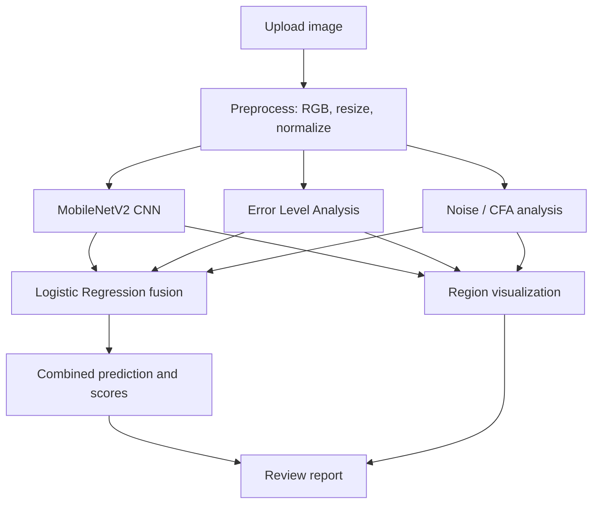

::: {align="center"}
# 🔍 Image Forgery Detection

### AI-powered image forensics using deep learning and digital evidence analysis

**Detect suspicious image manipulation. Combine multiple forensic
signals. Review potential regions of interest.**

```{=html}
<p>
```
``{=html}
``{=html}
``{=html}
``{=html}
```{=html}
</p>
```
:::📌 Overview
Image Forgery Detection is a research prototype designed to analyse
digital images for signs that they may have been manipulated. It
combines a convolutional neural network (CNN) with traditional
image-forensics techniques and a score-fusion model.

The system is designed to produce: - A combined prediction
indicating whether an image may be authentic or tampered. -
Technique-level scores from multiple forensic signals. - A visual
explanation intended to help reviewers inspect suspicious areas.
Important: This is a research and educational prototype, not a
definitive forensic authority. Model predictions can be wrong. Any
result should be independently reviewed before being used in
journalism, legal proceedings, or other high-stakes decisions.

✨ Highlights
  Capability                          What it does
  🧠 CNN-based analysis               Uses MobileNetV2 transfer learning
                                      to classify image patterns

  🧩 Error Level Analysis (ELA)       Examines differences introduced by
                                      JPEG recompression

  〰️ Noise / CFA analysis             Looks for inconsistencies in image
                                      noise and sensor-pattern clues

  ⚖️ Score fusion                     Combines detector scores with
                                      Logistic Regression

  🔥 Region visualization             Provides a heatmap-style view to
                                      support visual inspection

  🖥️ Web interface                    React frontend for image upload and
                                      result presentation

  ⚡ API backend                      FastAPI endpoints for health checks
                                  and detection
🧠 How It Works

Detection pipeline
1. Preprocessing --- the image is converted to RGB, resized to
   128 × 128, and normalized.
2. CNN analysis --- a MobileNetV2-based classifier produces a
   forgery-related score.
3. ELA analysis --- the image is recompressed and differences are
   analysed for suspicious patterns.
4. Noise / CFA analysis --- noise residuals and potential
   sensor-pattern inconsistencies are examined.
5. Score fusion --- the scores are combined using a Logistic
   Regression model.
6. Result presentation --- the interface displays the combined
   output, individual scores, and a visualization for further review.
🧰 Technology Stack
  Layer                               Technologies
  Deep learning                       PyTorch, MobileNetV2, Grad-CAM

  Image processing                    Pillow (PIL), NumPy, ELA and
                                      noise-residual analysis

  Fusion model                        Scikit-learn Logistic Regression

  Backend API                         FastAPI, Uvicorn

  Frontend                            React 19, TypeScript, Vite,
                                      Tailwind CSS

  Dataset                             CASIA 2.0
  Testing                             Pytest
📂 Dataset
The project documentation describes the CASIA 2.0 image-forgery
dataset with the following counts:

  Class         Approximate number of images Naming pattern
  Authentic                            7,491 Au_*
  Tampered                             5,123 Tp_*
  Total                       12,614 ---

The dataset includes authentic and manipulated examples, including
splicing and copy-move manipulations.

Dataset note: Obtain CASIA 2.0 from an authorized source and follow
its applicable terms. The dataset may not be included in this
repository. Place the files in the expected folders described below.
📊 Reported Model Results
The supplied project notes report the following CNN validation results:

  Metric                              Reported value
  Best validation accuracy                72.04%
  Best epoch                                  7 of 8
  Validation accuracy at epoch 1              66.81%
  Validation accuracy at epoch 8              71.19%
  Training loss, epoch 1 → 8         0.6331 → 0.3671

These figures are the reported CNN validation results, not an
independently verified end-to-end test score. Performance can vary on
images from different sources, compression levels, editing software, or
image formats. For a rigorous evaluation, use a held-out test set and
report precision, recall, F1-score, confusion matrix, and calibration.
🗂️ Project Structure
Image_Forgery/
├── backend/
│   ├── main.py                    # FastAPI endpoints
│   ├── pipeline.py                # Detection pipeline orchestration
│   ├── preprocessing.py           # Image preparation
│   ├── fusion_model.py             # Logistic Regression score fusion
│   ├── localization.py             # Heatmap / region visualization
│   └── techniques/
│       ├── copy_move.py
│       ├── double_compression.py
│       ├── ela.py
│       ├── metadata.py
│       ├── noise.py
│       └── splicing_cnn.py
├── frontend/
│   ├── src/
│   │   ├── App.tsx
│   │   ├── api/
│   │   ├── components/
│   │   └── types/
│   ├── package.json
│   └── vite.config.ts
├── models/                         # Trained model artifacts
├── notebooks/                      # Training scripts
├── tests/                          # Tests and sample files
├── requirements.txt
└── run.md                          # Additional run instructions
Folder names and files can differ between repository versions. Check
the actual files in your checkout before running commands.

🚀 Getting Started
Prerequisites
- Python 3.10 or newer
- Node.js and npm
- Git
- CASIA 2.0 dataset, if training or dataset-based evaluation is
  required
1. Clone the repository
git clone <YOUR_REPOSITORY_URL>
cd <YOUR_REPOSITORY_FOLDER>
Replace the placeholders with your repository URL and folder name.
2. Create a Python environment
Windows PowerShell / Command Prompt:
python -m venv .venv
.venv\Scripts\activate
python -m pip install --upgrade pip
pip install -r requirements.txt
macOS / Linux:
python3 -m venv .venv
source .venv/bin/activate
python -m pip install --upgrade pip
pip install -r requirements.txt
3. Prepare the dataset
If your local training scripts expect the CASIA 2.0 directory structure,
arrange the images like this:
data/
└── raw/
    └── CASIA2/
        ├── Au/
        │   ├── Au_*.jpg
        │   └── ...
        └── Tp/
            ├── Tp_*.jpg
            └── ...
Confirm the expected paths in the training scripts before moving or
renaming dataset files.
4. Train the models (if model files are not already available)
Run the scripts from the project root, adjusting their paths if your
checkout differs:
python notebooks/02_train_splicing_cnn.py
python notebooks/03_train_fusion_model.py
The supplied project notes identify these expected model artifacts:
models/splicing_cnn.pth
models/fusion_model.pkl
Training can take time and may require substantial memory. If the
trained artifacts are already present and compatible, you may be able to
skip training.
5. Start the FastAPI backend
From the project root, with the Python environment activated:
python -m uvicorn backend.main:app --host 127.0.0.1 --port 8000 --reload
Useful endpoints, if enabled in your current version:
- Health check: http://127.0.0.1:8000/health
- Interactive API documentation: http://127.0.0.1:8000/docs
6. Start the frontend
Open a second terminal:
cd frontend
npm install
npm run dev
Use the local URL printed by Vite in the terminal. The frontend may
require the backend API URL to be configured; check the project's
environment variables and API client settings if the interface cannot
reach the backend.
🧪 Example API Request
If your backend exposes a POST /detect endpoint that accepts a
multipart form field named file, you can test it with:
curl -X POST \
  -F "file=@tests/sample_forged.jpg" \
  http://127.0.0.1:8000/detect
Replace the sample path with an image that exists in your local project.
The exact request and response schema should be confirmed in
backend/main.py or the API docs.
🔎 Understanding the Output
  Output                              Interpretation
  Combined verdict                    Model-estimated class or
                                      probability based on the configured
                                      decision threshold

  CNN score                           Signal from the learned image
                                      classifier

  ELA score                           Signal derived from JPEG
                                      recompression differences

  Noise / CFA score                   Signal derived from noise residuals
                                      and potential sensor-pattern
                                      inconsistencies

  Heatmap                             Visual aid showing regions
                                      highlighted by the localization
                                  pipeline
A heatmap is not proof of tampering. It indicates areas the system
considers worth inspecting and should be compared with the original
image and other evidence.
⚠️ Limitations
- A validation accuracy of approximately 72% indicates substantial
  room for improvement.
- ELA can be affected by normal recompression, resizing, and export
  workflows.
- Noise and CFA clues can be weakened by denoising, screenshots,
  social-media processing, or images that have passed through multiple
  devices.
- CNNs may learn dataset-specific patterns that do not generalize to
  real-world images.
- A combined score is only as reliable as its training data, score
  calibration, and evaluation design.
- Localization quality should be evaluated separately from image-level
  classification.
- The system should not be treated as a replacement for expert
  forensic analysis.
🛣️ Potential Improvements
- Fine-tune more of the MobileNetV2 backbone and evaluate suitable
  data augmentation.
- Establish a clean, leakage-resistant train/validation/test split.
- Report per-class precision, recall, F1-score, ROC-AUC, and a
  confusion matrix.
- Calibrate the fusion output and evaluate its performance on external
  datasets.
- Evaluate localization against ground-truth manipulation masks.
- Add robust input validation, file-size limits, clear API errors, and
  structured logging.
- Benchmark performance on recompressed, resized, and real-world
  images.
👥 Contributing
Contributions, bug reports, and suggestions are welcome.
1. Fork the repository.
2. Create a feature branch: git checkout -b feature/your-change
3. Commit your changes: git commit -m "Describe your change"
4. Push the branch: git push origin feature/your-change
5. Open a pull request with a clear description and test notes.
📜 License & Dataset
Add the project's software license and dataset attribution/terms here
before public release. Do not assume the software license also grants
rights to redistribute the CASIA 2.0 dataset.
::: {align="center"}
**Built for learning, experimentation, and responsible image-forensics
research.**

*Treat every automated result as a lead to investigate---not a final
verdict.*
:::
